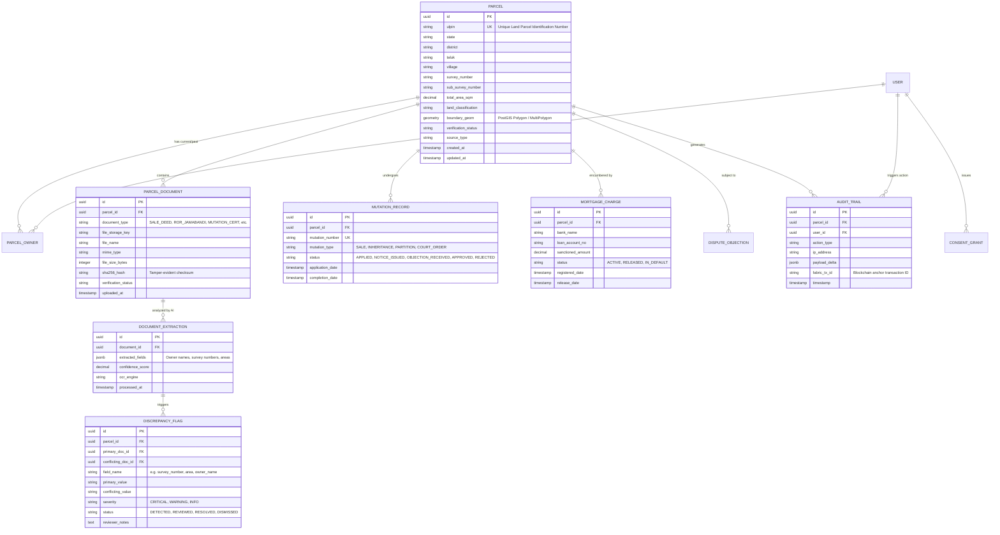

# LandClarity Domain Data Model Specification

## 1. Core Entity Relationship Overview

The core domain model is anchored around the **`Parcel`** entity, connecting spatial boundaries, ownership ledgers, physical deeds, encumbrances, and mutation events.

---

## 2. Spatial Geometry Standards
- **CRS (Coordinate Reference System)**: WGS 84 (`EPSG:4326`) for GeoJSON exchange; projected system (such as UTM or EPSG:3857) for precise metric area calculations in PostGIS.
- **Geometry Types**: `POLYGON` or `MULTIPOLYGON` with standard topological validity checks (`ST_IsValid`, `ST_MakeValid`).
- **Cadastral Labels**: Each geometry boundary has a recorded status:
  - `OFFICIAL_GOVERNMENT`: Sourced from certified cadastral vectors.
  - `SURVEYOR_VERIFIED`: Measured and signed by a licensed ground surveyor.
  - `USER_SUBMITTED`: Indicative boundary uploaded by citizen/agent.
  - `APPROXIMATE`: Estimated centroid or buffer for discovery purposes.
