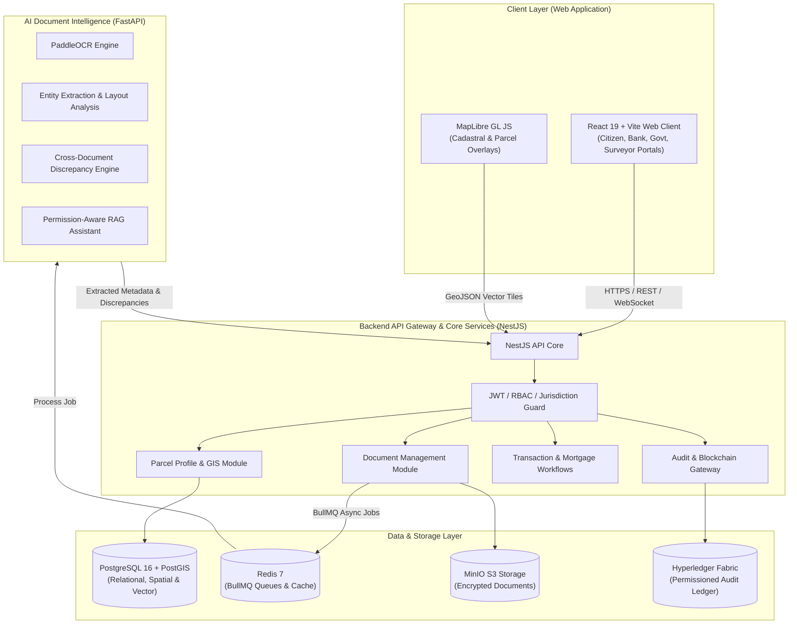
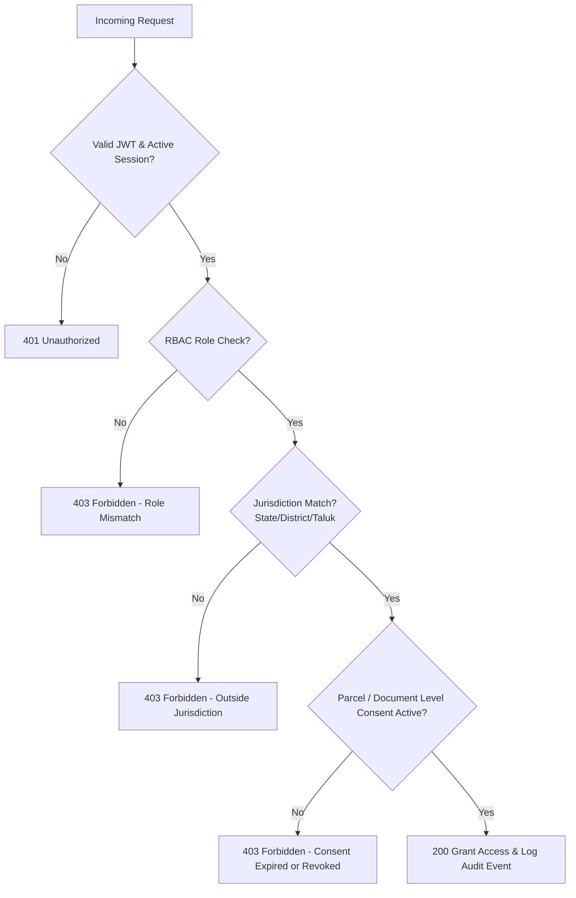

# LandClarity System Design & Architecture Specification

## 1. Architectural Principles & Boundaries

LandClarity is architected with clear boundaries to ensure security, high performance, strict regulatory compliance, and auditability:

1. **Strict Legal Non-Delegation Principle**:
   - LandClarity does not adjudicate ownership or issue binding title certificates.
   - It serves as an authoritative aggregation, verification, and decision-support platform for citizens, banks, and authorized officers.
   - AI outputs are advisory flags with page/line citations; human-in-the-loop sign-off is required for all state transitions.

2. **Off-Chain Document & PII Privacy**:
   - Personally Identifiable Information (PII) and raw document binaries are **never** stored on the blockchain.
   - Documents are securely stored in private MinIO/S3 object storage with AES-256 encryption.
   - Only cryptographic digests (SHA-256), verification state hashes, and immutable audit events are anchored to the blockchain.

3. **Spatial Rigor (PostGIS Engine)**:
   - Geometry calculations, coordinate transformations, polygon area verifications, and overlap detections are strictly executed within PostGIS (`ST_Area`, `ST_Intersects`, `ST_Overlaps`).
   - LLMs are strictly prohibited from generating or calculating geometric boundaries.

---

## 2. High-Level System Architecture

---

## 3. The 17 Core Functional Modules

| # | Module Name | Description & Boundary Responsibility |
|---|---|---|
| **1** | **Public Land Discovery & GIS Map** | Anonymous/public cadastral parcel search by village, survey number, or coordinates. |
| **2** | **Citizen & Landowner Portal** | Self-service portal for managing landholdings, consent requests, and buyer inquiries. |
| **3** | **Digital Land Parcel Profile** | Central single-pane-of-glass record linking survey, ownership, mutation, tax, and deeds. |
| **4** | **Property Listing & Marketplace** | Verified listings backed by active parcel IDs, preventing duplicate or fraudulent ads. |
| **5** | **Ownership & Document Verification** | Multi-tier review queue for advocates, legal officers, and registration clerks. |
| **6** | **AI Document Intelligence** | Automated OCR, entity extraction (deed vs. RoR), confidence scoring, and discrepancy detection. |
| **7** | **Land Transaction & Sale Workflow** | End-to-end milestone tracker: due diligence, escrow/intent, token payment, registration reference. |
| **8** | **Inheritance & Ownership Update** | Legal heirship documentation submission, public notice period, objection queue, mutation tracking. |
| **9** | **Bank & Mortgage Management** | Digital loan search pack, charge creation/satisfaction, valuation report attachment. |
| **10** | **GIS & Survey Management** | Cadastral boundaries, sub-division verification, boundary disputes, surveyor field notes. |
| **11** | **Dispute & Record Correction** | Formal objection filing, evidence attachment, hearing dates, and resolution logging. |
| **12** | **Blockchain Integrity & Audit** | Immutable tamper-evident log of document hashes, status transitions, and mutation approvals. |
| **13** | **Government Officer Dashboard** | Queue management for Revenue Officers, Tehsildars, and Sub-Registrars. |
| **14** | **Notifications & Communication** | SMS, email, and in-app alerts for milestone updates, objection notices, and consent requests. |
| **15** | **AI Land Records Assistant** | Natural-language query interface constrained strictly to the authenticated user's authorized records. |
| **16** | **Reports & Administrative Analytics**| Aggregate statistics on pending mutations, mortgage exposure, and land classification distribution. |
| **17** | **Security, Consent & Access Control**| Time-bounded co-owner consent, token rotation, audit logs, and jurisdiction-based filtering. |

---

## 4. Multi-Level Access Control Matrix

Access is enforced using a 4-dimensional matrix:
`CanAccess(User, Resource, Action) = RolePermission ∧ JurisdictionMatch ∧ ResourceConsent ∧ DocumentSensitivity`

